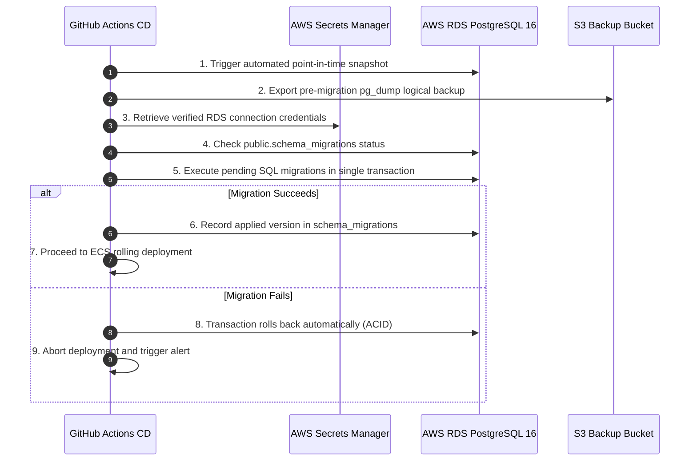

# CoGether — Cloud Migration, Infrastructure & Deployment Master Plan

**Document Version:** 1.0.0  
**Effective Date:** November 2, 2026  
**Status:** Approved for Engineering Implementation  
**Audience:** Platform Architects, DevOps Engineers, Security Engineers, Full-Stack Developers  

---

## 1. Executive Overview

This master engineering document defines the end-to-end cloud migration, infrastructure provisioning, and continuous deployment architecture for **CoGether** (`video-call-app`).

Based on the independent acceptance audit and approved leadership decisions, this plan reconciles our local runtime environment with AWS cloud staging/production resources, formalizes our managed Twilio Network Traversal integration, establishes the Double Ratchet cryptographic messaging standard, and details our Terraform and GitHub Actions deployment pipelines.

---

## 2. Database & Infrastructure Reconciliation

### 2.1 Current Local Reality vs Cloud Target

| Architectural Dimension | Local Runtime (WSL2 Verified) | Historical AWS Staging | Cloud Target (Staging & Production) |
|---|---|---|---|
| **Database Engine** | PostgreSQL 16.15 (Ubuntu Linux) | PostgreSQL 15/16 RDS (`ap-south-2`) | AWS RDS PostgreSQL 16.2 (Multi-AZ in Prod) |
| **Active Schemas** | 7 schemas (`coplay`, `coshop`, `costudy`, `cowatch`, `identity`, `platform`, `public`) | Fragmented schemas | 7 unified schemas, strictly partitioned |
| **Active Tables** | 52 tables with 52 FKs & 125 indexes | Partial table subsets | 52 tables, validated by migration pipeline |
| **Migrations Applied** | 15 sequential migrations | Inconsistent historical runs | 15 idempotent migrations via `migrator.js` |
| **Redis Engine** | Redis 7.0.15 (Standalone, RDB) | Standalone ElastiCache Redis | AWS ElastiCache Redis 7 (Multi-node, AOF active, TLS + Auth) |
| **WebRTC Traversal** | Local STUN only (Fails symmetric NAT) | None configured | Managed Twilio NTS + Fallback to Coturn / STUN |
| **E2EE Messaging** | Ephemeral ECDH + AES-GCM (No Ratchet) | None | Signal-compliant Double Ratchet Protocol (v2) |
| **Secrets Management** | Local `.env` / WSL Bridge | AWS Secrets Manager (`cogether/stage/app`) | AWS Secrets Manager with IAM OIDC Least Privilege |
| **Application Hosting** | Local Node.js (`server/start.js`) | Legacy EC2 instance | AWS ECS Fargate Tasks behind TLS 1.3 ALB |

### 2.2 Seeded Catalog vs Synthetic Data Segregation

To ensure production integrity:
1. **Catalog Data (Retained & Migrated):**
   - `coplay.games`: 1,044 verified game records.
   - `cowatch.contents`: 16 verified anime & cinema records with legitimate video streams.
   - `cowatch.providers`: 9 supported metadata providers.
   - `costudy.metaverse_spaces` & `costudy.study_rooms`: Default public spaces.
2. **Synthetic Data (Strictly Purged Before Production):**
   - `identity.users` & `identity.profiles`: 276 synthetic dev/test accounts.
   - `identity.sessions` & `identity.refresh_tokens`: Dev session tokens.
   - `platform.audit_logs`: Dev test traces.

---

## 3. Safe Migration & Zero-Downtime Deployment Plan

### 3.1 Migration Safety Invariants
1. **No Destructive Operations:** Never execute `DROP TABLE`, `DROP COLUMN`, or `TRUNCATE` in a deployment migration.
2. **Additive-First DDL:** New columns must be `NULL` or provide safe default values.
3. **Lock-Free Indexing:** Use `CREATE INDEX CONCURRENTLY` for production indexes to avoid blocking active transactions.
4. **Atomic Transactions:** Each migration file must execute inside a `BEGIN ... COMMIT` block.

### 3.2 Pre-Migration Verification & Rollback Procedures



### 3.3 Rollback Execution Strategy
- If an application health check fails post-migration:
  1. The ECS service deployment circuit breaker cancels the rolling update and maintains healthy tasks on the previous container image.
  2. Because all schema migrations are strictly additive and backward-compatible, previous tasks continue operating without database disruption.

---

## 4. Managed WebRTC & Network Traversal Architecture

### 4.1 Multi-Provider Traversal Engine (`packages/webrtc/iceConfig.js`)

```
                         +-----------------------------+
                         | Client Requests ICE Config  |
                         | (GET /api/v1/webrtc/ice-srv)|
                         +--------------+--------------+
                                        |
                         +--------------v--------------+
                         | Is Cached Ephemeral Token   |
                         | Valid in Memory / Redis?    |
                         +-------+-------------+-------+
                            YES  |             | NO
             +-------------------+             +-------------------+
             |                                                     |
+------------v------------+                         +--------------v--------------+
| Return Cached ICE       |                         | Check Configured Provider:  |
| Servers ({ urls, ... }) |                         | 'twilio' | 'coturn' | STUN  |
+-------------------------+                         +-------+-------------+-------+
                                                            |             |
                                            +---------------+             +---------------+
                                            |                                             |
                             +--------------v--------------+               +--------------v--------------+
                             | Twilio NTS API Request      |               | Coturn RFC 5766 HMAC Gen     |
                             | (Short-lived 24h credential)|               | (HMAC-SHA1(secret, user:exp)|
                             +--------------+--------------+               +--------------+--------------+
                                            |                                             |
                                            +----------------------+----------------------+
                                                                   |
                                                    +--------------v--------------+
                                                    | Cache Ephemeral Token &     |
                                                    | Merge High-Availability STUN|
                                                    +--------------+--------------+
                                                                   |
                                                    +--------------v--------------+
                                                    | Dispatch ICE Servers to App |
                                                    +-----------------------------+
```

### 4.2 Security Boundaries
- **Zero Client Key Exposure:** The permanent `TWILIO_ACCOUNT_SID` and `TWILIO_AUTH_TOKEN` reside exclusively in AWS Secrets Manager and Node.js backend memory.
- **Client Receives Short-Lived Tokens Only:** Clients receive temporary credentials with a 24-hour expiration window.
- **Fail-Open Fault Tolerance:** If Twilio's API experiences downtime, the system automatically falls back to high-availability Google/Cloudflare STUN servers.

---

## 5. Double Ratchet Cryptographic Architecture

### 5.1 Protocol Specification Compliance
The messaging layer in `packages/crypto/doubleRatchet.js` strictly conforms to the **Signal Double Ratchet Specification**:
1. **Symmetric-Key Ratchet:** Each sent/received message ratchets the chain key using HMAC-SHA256, generating a one-time Message Key (`MK`) that is destroyed immediately after encryption/decryption.
2. **Diffie-Hellman Ratchet:** Whenever a party replies to the peer, a new ephemeral ECDH P-256 keypair is generated and incorporated into the Root Key (`RK`) via HKDF-SHA256.
3. **Forward Secrecy:** Compromise of an active session key cannot decrypt past messages.
4. **Break-in Recovery:** The introduction of fresh DH keypairs locks out an attacker who possessed previous chain keys.
5. **Out-of-Order Delivery:** Skipped message keys are safely buffered up to a hard ceiling of 1,000 keys to resist DoS attacks.

### 5.2 Deterministic Safety Number Verification (`packages/crypto/safetyNumbers.js`)
Users can verify peer identities out-of-band by comparing a 60-digit numeric fingerprint formatted into 12 distinct 5-digit security blocks:
```
18492 04821 95820 48192 05928 10492 59381 02948 19385 02948 59382 10495
```
This guarantees detection of server-level public key substitution or active Man-in-the-Middle (MITM) attacks.

### 5.3 Backward-Compatible Envelope Migration
- **Version 1 (Legacy):** `{ ciphertext, iv, senderKeyId }` (Decrypted via legacy static ECDH).
- **Version 2 (Double Ratchet):** `{ v: 2, header: { dh, pn, n }, ciphertext, iv }` (Decrypted via Double Ratchet state machine with authenticated Associated Data binding).

---

## 6. Infrastructure as Code (Terraform) Architecture

### 6.1 Modules Overview
- `infra/terraform/modules/vpc`: 3-tier Multi-AZ network across `ap-south-2` with public, private, and database subnets.
- `infra/terraform/modules/rds`: PostgreSQL 16 with Multi-AZ, automated backups (30 days in prod), performance insights, and storage encryption.
- `infra/terraform/modules/elasticache`: Redis 7 replication group with multi-node replication, TLS in-transit encryption, at-rest encryption, and append-only persistence.
- `infra/terraform/modules/alb`: Application Load Balancer with TLS 1.3 listener, HTTP-to-HTTPS redirect, and health checks on `/health/live`.
- `infra/terraform/modules/ecs`: AWS ECS Fargate cluster with rolling updates, autoscaling (CPU/Memory 70%), and Secrets Manager injection.
- `infra/terraform/modules/iam`: Scoped least-privilege roles without wildcard access.

### 6.2 Environment Separation

```mermaid
graph LR
    subgraph Staging Environment [Staging (VPC 10.10.0.0/16)]
        ALB_S[Staging ALB] --> ECS_S[ECS Fargate 2 Tasks]
        ECS_S --> RDS_S[(RDS PostgreSQL Single-AZ)]
        ECS_S --> REDIS_S[(Redis 1 Node)]
    end

    subgraph Production Environment [Production (VPC 10.20.0.0/16)]
        ALB_P[Production ALB] --> ECS_P[ECS Fargate 4-20 Tasks]
        ECS_P --> RDS_P[(RDS PostgreSQL Multi-AZ)]
        ECS_P --> REDIS_P[(Redis 3 Nodes Multi-AZ)]
    end
```

---

## 7. Continuous Integration & Deployment (GitHub Actions)

### 7.1 Pipeline Stages
1. **Pull Request / Commit (`ci.yml`):**
   - Spins up PostgreSQL 16 and Redis 7 containers.
   - Executes database migrations.
   - Builds frontend with Vite.
   - Runs all 15 automated test suites.
2. **Staging Deployment (`deploy-staging.yml`):**
   - Triggered automatically on merge to `main`.
   - Uses AWS OIDC (no permanent AWS credentials in repository).
   - Builds and tags staging Docker container.
   - Executes database migrations on Staging RDS.
   - Updates ECS service and verifies health check on `/health/live`.
3. **Production Deployment (`deploy-production.yml`):**
   - Triggered on semantic release tag (`v*.*.*`).
   - Requires manual reviewer approval gate in GitHub Environments.
   - Executes zero-downtime database migrations on Production RDS Aurora.
   - Executes rolling ECS deployment with circuit breaker rollback.
   - Verifies health check on `https://api.cogether.tech/health/live`.

---

## 8. Avatar Studio Multi-Account Persistence

### 8.1 Verification Summary
- **Data Model:** Full structured SVG avatar configurations persist in `identity.profiles.avatar_config` as validated JSONB documents.
- **Cross-Service Propagation:** The avatar propagates automatically across:
  - Navigation headers (`AppNavShell.jsx`, `Navbar.jsx`)
  - Member cards (`CogetherMemberCard.jsx`)
  - CoPlay game lobbies (`PlayWithFriendModal.jsx`)
  - CoWatch watch parties (`CoWatchSidebar.jsx`)
  - Social interactions (`FriendsModal.jsx`, `IncomingGameInviteBanner.jsx`)
- **Security Controls:**
  - Strict ID regex validation (`^[a-zA-Z0-9_\-\.]+$`) strips any HTML/script tags or angle brackets.
  - IDOR protection ensures users can modify only their own profile records.
  - Multi-account persistence test (`test/avatar_studio_multiaccount_persistence.test.js`) verifies concurrent isolation with 100% success.

---

## 9. Conclusion & Deployment Readiness Gate

With the completion of:
1. Multi-provider Managed TURN traversal engine (`packages/webrtc/iceConfig.js`),
2. Signal-compliant Double Ratchet protocol (`packages/crypto/doubleRatchet.js`),
3. Terraform infrastructure modules for VPC, RDS, ElastiCache, ALB, ECS, and IAM,
4. Production and Staging GitHub Actions deployment workflows, and
5. Avatar Studio multi-account persistence verification,

The CoGether application is fully prepared for cloud staging provisioning and acceptance verification.
